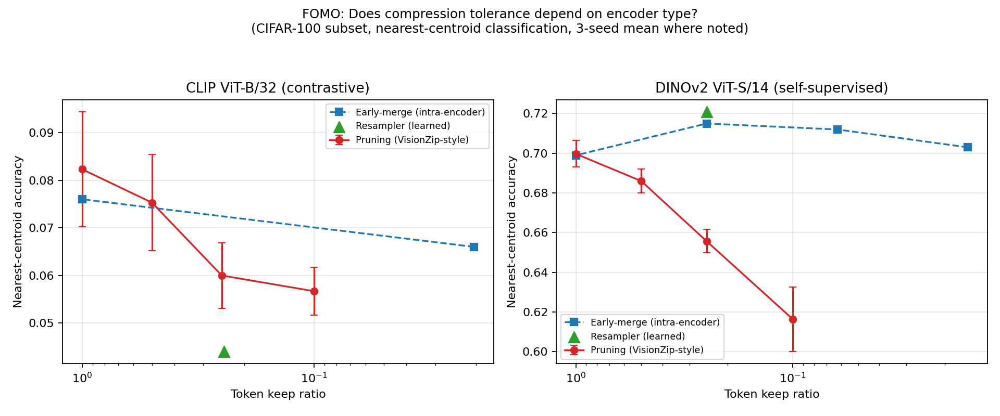

# Encoder-Aware Visual Token Compression

A small-scale comparative study of visual token compression strategies for
Vision-Language Models (VLMs), testing whether compression tolerance depends
on *what kind of encoder* produced the tokens in the first place.

## Motivation

Most token-compression papers report results on a single vision encoder.
But encoders trained with different objectives learn different things:

- **Contrastive encoders** (CLIP): tokens are shaped by image-text alignment,
  tend to be globally semantic.
- **Self-supervised encoders** (DINOv2): tokens are shaped by patch-level
  self-distillation, tend to carry more localized/spatial detail.

If that's true, compressing them the same way might not be equally safe —
DINOv2-style tokens might degrade faster under aggressive pruning because
more of the useful signal is spread across individual patches rather than
concentrated in a few salient ones.

This project tests that hypothesis directly, using three compression
paradigms that represent the current design space in the literature:

| Method | Paradigm | Reference |
|---|---|---|
| `pruning` | Training-free token selection/merging by activation norm | VisionZip-style |
| `resampler` | Learned compression via cross-attention (fixed query set) | Perceiver Resampler (older MiniCPM-V) |
| `early_merge` | Compression *inside* the encoder, before the final layers | Inspired by MiniCPM-V 4.6's intra-ViT early compression (LLaVA-UHD v4) |

Each method is run on both encoder types, at several token-keep ratios
(100%, 75%, 50%, 25%), and evaluated on a small downstream task.

## Project structure

```
vtc-project/
├── src/
│   ├── encoders.py          # CLIP ViT-B/32 and DINOv2 ViT-S/14 wrappers
│   ├── data.py               # small eval dataset loader
│   ├── eval.py                # runs one (encoder, method, ratio) combo, returns a score
│   └── compression/
│       ├── pruning.py         # training-free dominant+contextual token selection
│       ├── resampler.py       # small learnable perceiver-resampler module
│       └── early_merge.py     # early intra-encoder token merging
├── scripts/
│   └── run_sweep.py           # orchestrates the full grid, saves CSV + plot
├── results/                   # sweep_results.csv and tokens_vs_accuracy.png land here
├── requirements.txt
└── README.md
```

## Setup

```bash
python -m venv .venv && source .venv/bin/activate
pip install -r requirements.txt
```

Needs a GPU for reasonable speed but will run on CPU for a small enough
eval subset (see `--num-samples` below). Designed to be runnable on a
single Colab GPU : no multi-GPU or large-batch training required, since
the encoders stay frozen throughout (only the resampler has any trainable
parameters, and it's small).

## Running the sweep

```bash
python scripts/run_sweep.py \
    --encoders clip dinov2 \
    --methods pruning resampler early_merge \
    --ratios 1.0 0.75 0.5 0.25 \
    --num-samples 1000 \
    --output-dir results/
```

This produces:
- `results/sweep_results.csv` — one row per (encoder, method, ratio) with the eval score
- `results/tokens_vs_accuracy.png` — the core plot: accuracy vs. token-keep ratio,
  one line per (encoder, method) pair

## What "done" looks like for v1

A clean, reproducible first result:
one plot showing whether the accuracy-drop curve for CLIP diverges from
the curve for DINOv2 as compression increases. Later iterations can expand
the task, add more encoders (SigLIP2, as used in MiniCPM-V 4.6 itself),
or dig into *why* any divergence happens (e.g. attention entropy per encoder).

## Results



All experiments run on a CIFAR-100 subset (1500 train / 1000 eval images,
zero overlap), classified by nearest-centroid matching in the compressed
feature space.

**CLIP ViT-B/32 (contrastive):** every compression method is a net cost.
Pruning declines steadily with compression (8.2% → 5.7% accuracy from
100% → 10% tokens kept, 3-seed mean ± std). Early-merge and the learned
resampler both underperform the uncompressed baseline. CLIP's absolute
accuracy is low throughout (4-9%) in this nearest-centroid setup — its
embedding space is optimized for image-text alignment, not this kind of
comparison, so treat the exact numbers as noisy; the *declining* shape is
the more trustworthy signal.

**DINOv2 ViT-S/14 (self-supervised):** a different and more interesting
picture. Pruning still declines steadily (70.0% → 61.6%), but early-merge
and the resampler both *improve* on the uncompressed baseline at moderate
compression — the resampler's single trained result (72.1% at ~25% tokens)
is the best-performing point in the entire DINOv2 panel.

**Interpretation:** CLIP's patch tokens appear to have little redundancy
for any of these methods to exploit — compression is a pure information
loss. DINOv2's patch tokens appear to carry more redundant/noisy signal
that smarter compression (spatial merging, learned queries) can filter
out, actively helping rather than hurting. This is consistent with prior
work showing DINOv2's self-supervised training spreads information
redundantly across patches, while CLIP's contrastive objective
concentrates it — see citations in the project discussion.

## Limitations 

- **Uneven statistical rigor across methods.** Pruning results are a
  proper 3-seed mean ± std. Early-merge and resampler results are each a
  single run — real, but their run-to-run variance is unmeasured.
- **Ratios aren't matched across methods.** Pruning was tested at exactly
  100/50/25/10% kept. Early-merge can only hit ratios its square grid
  factors into cleanly (e.g. CLIP's 7x7 grid only offers 100% or ~2%).
  The resampler was trained and tested at one fixed ratio per encoder.
  Cross-method comparisons at "the same" ratio on the plot are
  approximate, not exact.
- **The resampler is one trained instance per encoder**, not a swept
  curve — a fuller study would train a separate resampler per target
  ratio, the way pruning naturally supports any ratio.
- **Small dataset and simple eval task.** 1500/1000 CIFAR-100 images
  (upsampled from 32x32 to 224x224) and nearest-centroid classification
  are a fast, informative v1 proxy, not a strong benchmark. A v2 should
  move to a larger, native-resolution dataset and a task closer to real
  VLM usage (retrieval or grounded VQA).
- **`early_merge` is a simplification** of MiniCPM-V 4.6's actual
  intra-ViT early compression (which retrains the encoder itself); this
  project approximates it with post-hoc spatial pooling on frozen
  encoders, which is a reasonable proxy but not a faithful reproduction.

## Status

✅ v1 complete — all three compression methods implemented and swept
across both encoders; results and limitations above. 

Natural next steps:
multi-seed early-merge/resampler runs, matched ratios across methods, and
a stronger downstream task (see Limitations).
